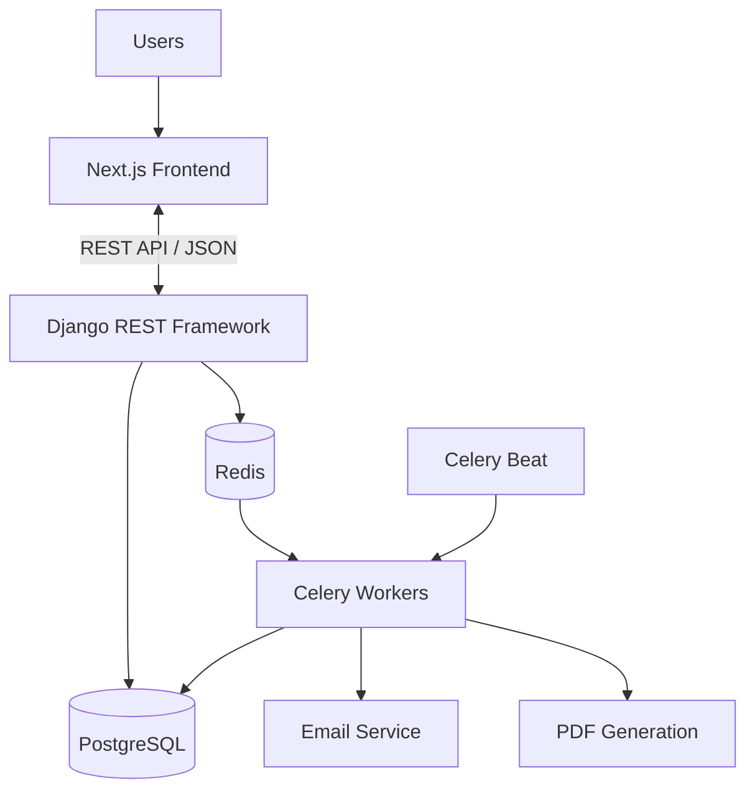
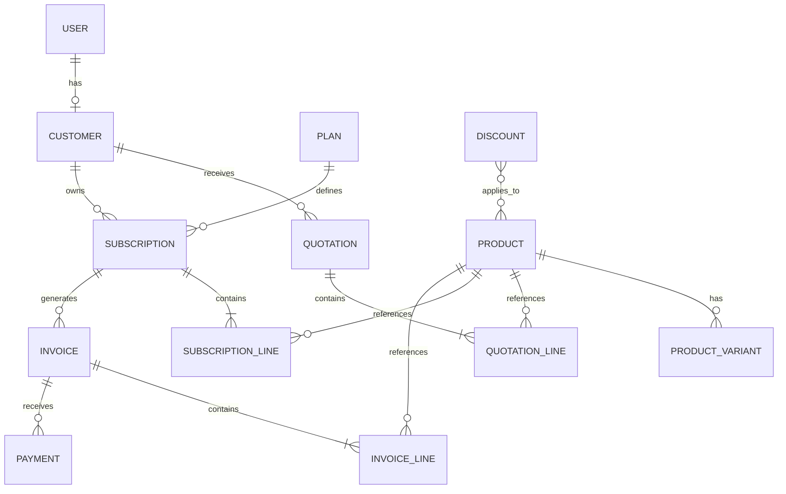
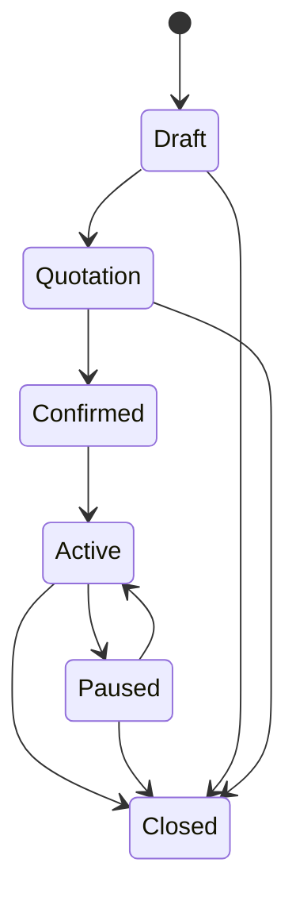
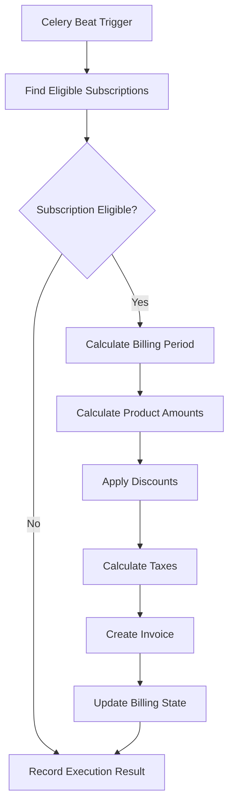
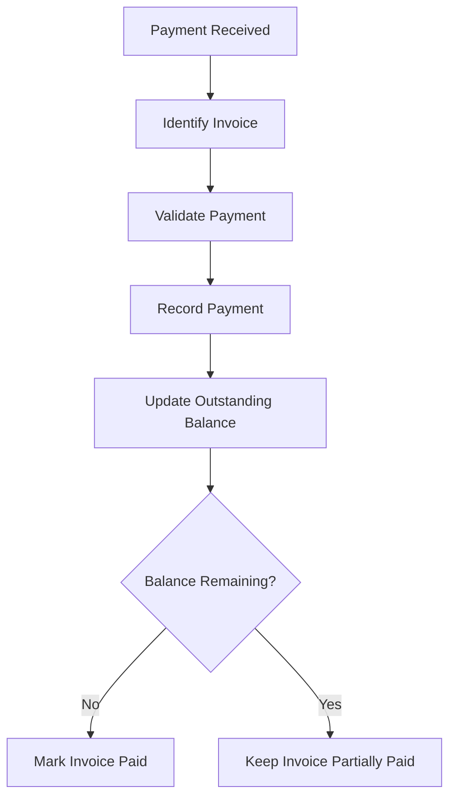
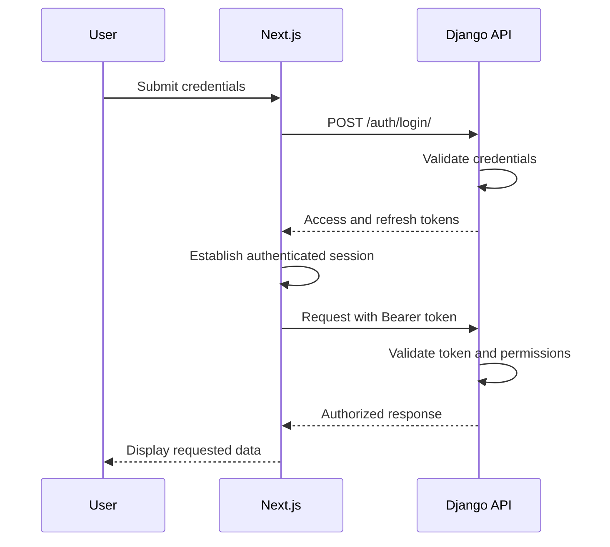
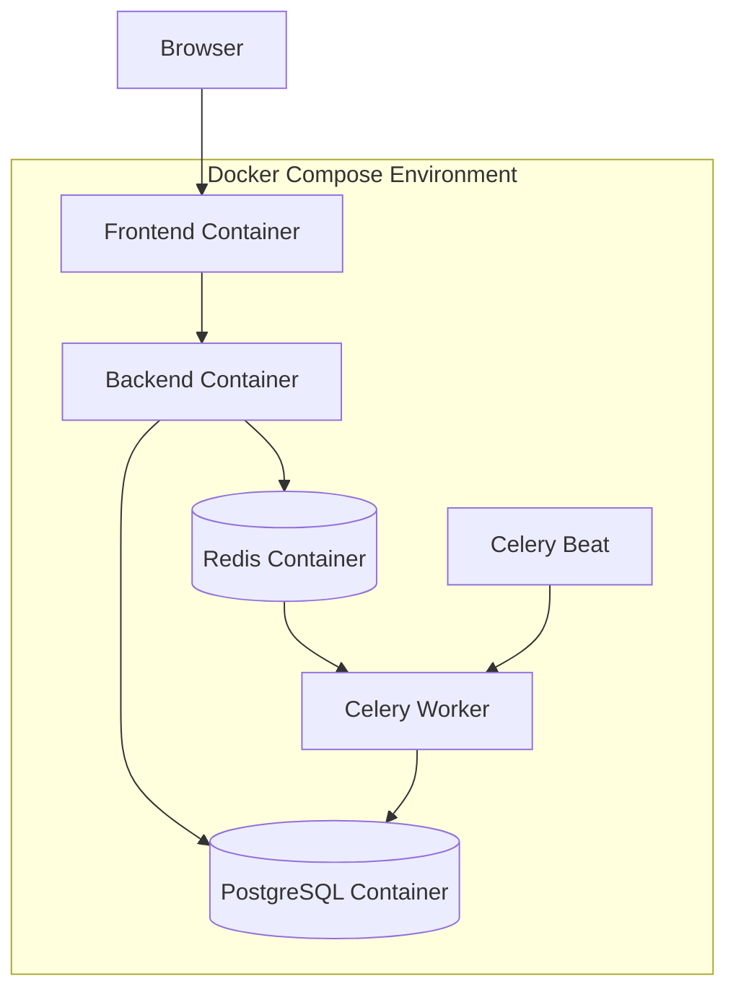

# System Architecture

**Project:** Subscription Management System  
**Architecture Style:** Modular Monolith  
**Frontend:** Next.js  
**Backend:** Django REST Framework  
**Database:** PostgreSQL  
**Infrastructure:** Docker Compose  
**API Version:** v1

---

## 1. Architecture Overview

The Subscription Management System follows a modular monolithic architecture with independently structured frontend and backend applications.

The frontend communicates with the backend through REST APIs.

The backend manages business logic, data validation, authentication, financial calculations and subscription lifecycle operations.

PostgreSQL serves as the primary persistent database, while Redis supports caching and asynchronous task processing through Celery.

### High-Level Architecture



---

## 2. Application Layers

The application is organized into five major layers.

### 2.1 Presentation Layer

**Technology:** Next.js, TypeScript, Tailwind CSS, shadcn/ui.

Responsibilities:

- Render application interfaces.
- Manage navigation.
- Handle user input.
- Perform client-side validation.
- Display business data.
- Communicate with backend APIs.
- Manage loading and error states.

The frontend contains three primary application experiences:

1. Admin dashboard.
2. Staff operational interface.
3. Customer self-service portal.

### 2.2 API Layer

**Technology:** Django REST Framework.

Responsibilities:

- Expose REST endpoints.
- Authenticate users.
- Enforce permissions.
- Validate incoming requests.
- Serialize outgoing responses.
- Handle pagination and filtering.
- Coordinate business services.

API namespace:

```text
/api/v1/
```

### 2.3 Business Logic Layer

**Technology:** Python and Django services.

Responsibilities:

- Product and variant pricing.
- Plan validation.
- Quotation conversion.
- Subscription lifecycle management.
- Billing period calculations.
- Tax calculations.
- Discount application.
- Invoice generation.
- Payment reconciliation.
- Financial reporting.

Complex business logic must remain outside HTTP views.

### 2.4 Data Layer

**Technology:** PostgreSQL and Django ORM.

Responsibilities:

- Store application records.
- Maintain relational integrity.
- Enforce uniqueness constraints.
- Support database transactions.
- Provide indexed queries.
- Preserve financial history.

### 2.5 Background Processing Layer

**Technology:** Celery, Celery Beat and Redis.

Responsibilities:

- Schedule recurring billing.
- Generate invoices asynchronously.
- Process subscription expiry.
- Send notifications.
- Retry transient failures.
- Perform scheduled maintenance tasks.

---

## 3. Backend Module Architecture

The backend uses a modular structure based on business domains.

```text
backend/
│
├── config/
│   ├── settings/
│   ├── urls.py
│   ├── celery.py
│   └── wsgi.py
│
├── apps/
│   ├── accounts/
│   ├── customers/
│   ├── products/
│   ├── plans/
│   ├── quotations/
│   ├── subscriptions/
│   ├── invoicing/
│   ├── discounts/
│   ├── payments/
│   └── analytics/
│
├── services/
├── workers/
└── tests/
```

### 3.1 Accounts Module

Manages:

- User accounts.
- Authentication.
- JWT tokens.
- Password reset.
- Roles and permissions.
- Staff account creation.

### 3.2 Customers Module

Manages:

- Customer profiles.
- Customer information.
- Customer records.
- Customer-level data access.

### 3.3 Products Module

Manages:

- Products.
- Product types.
- Sales prices.
- Cost prices.
- Product variants.
- Additional variant pricing.

### 3.4 Plans Module

Manages:

- Subscription plans.
- Billing intervals.
- Minimum quantities.
- Availability dates.
- Lifecycle configuration.

### 3.5 Quotations Module

Manages:

- Quotation templates.
- Quotation creation.
- Quotation validity.
- Quotation line items.
- Quotation conversion.

### 3.6 Subscriptions Module

Manages:

- Subscription creation.
- Subscription numbering.
- Subscription line items.
- Subscription status.
- Renewal.
- Pause and resume.
- Expiry and closure.

### 3.7 Invoicing Module

Manages:

- Invoice generation.
- Invoice line items.
- Tax calculations.
- Invoice status.
- Invoice PDF generation.
- Billing history.

### 3.8 Discounts Module

Manages:

- Fixed discounts.
- Percentage discounts.
- Eligibility rules.
- Minimum purchase requirements.
- Usage limits.
- Discount expiry.

### 3.9 Payments Module

Manages:

- Payment records.
- Payment methods.
- Invoice reconciliation.
- Partial payments.
- Outstanding balances.

### 3.10 Analytics Module

Manages:

- Revenue summaries.
- Active subscription counts.
- Payment statistics.
- Outstanding invoices.
- Overdue invoice reports.

---

## 4. Database Architecture

PostgreSQL is the primary relational database.

The following represents the initial conceptual entity relationships. Exact field definitions, cardinalities and constraints will be finalized in `database-schema.md`.

### Core Entities

| Entity | Purpose |
|---|---|
| User | Authentication and roles |
| Customer | Customer profile |
| Product | Product catalogue |
| ProductVariant | Product variants |
| Plan | Subscription plan |
| Quotation | Customer quotation |
| QuotationLine | Quotation items |
| Subscription | Subscription record |
| SubscriptionLine | Subscription items |
| Invoice | Billing record |
| InvoiceLine | Invoice items |
| Discount | Discount rules |
| Payment | Payment records |

### Entity Relationship Diagram



### Database Design Principles

- Use relational foreign keys.
- Use unique constraints for business identifiers.
- Use database transactions for financial operations.
- Use appropriate indexes for frequently queried fields.
- Preserve historical prices on invoice lines.
- Prevent deletion of referenced financial records.
- Use decimal fields for monetary values.
- Store timestamps consistently in UTC.

---

## 5. Subscription Lifecycle Architecture

Subscriptions follow a controlled lifecycle.

### Subscription States

- Draft
- Quotation
- Confirmed
- Active
- Paused
- Closed

### Lifecycle Diagram



The backend is responsible for validating permitted transitions.

Invalid transitions must be rejected with an appropriate business-rule error.

Renewal is an operation that extends or creates the appropriate subscription period according to the chosen renewal policy. It is not assumed to be a separate lifecycle status.

---

## 6. Recurring Billing Architecture

Recurring billing is one of the most important components of the system.

### Components

- PostgreSQL stores subscriptions and billing periods.
- Celery Beat schedules recurring billing tasks.
- Redis acts as the Celery broker.
- Celery workers execute billing jobs.
- Django services calculate invoice amounts and create invoices.

### Billing Flow



### Billing Reliability Requirements

- Do not generate invoices for ineligible subscriptions.
- Prevent duplicate invoices for the same subscription and billing period.
- Use database transactions.
- Use unique constraints for billing periods.
- Make retry operations safe.
- Record task execution results.
- Handle failed jobs without losing billing records.

The billing engine must not depend on the assumption that a scheduled task executes exactly once.

---

## 7. Invoice & Payment Architecture

### Invoice Calculation

The invoice amount is derived from:

```text
Product Amount
    ↓
Variant Pricing
    ↓
Quantity Calculation
    ↓
Discount Application
    ↓
Tax Calculation
    ↓
Final Invoice Total
```

All monetary calculations are performed on the backend using decimal arithmetic.

### Payment Flow



Payments must be associated with the correct invoice.

Partial payments must be supported, and duplicate payment records must be prevented through appropriate transaction and idempotency controls.

---

## 8. Frontend Architecture

The frontend is implemented using Next.js and TypeScript.

```text
frontend/
│
├── app/
│   ├── login/
│   ├── register/
│   │
│   ├── dashboard/
│   │
│   ├── products/
│   ├── plans/
│   ├── quotations/
│   ├── subscriptions/
│   ├── invoices/
│   ├── discounts/
│   ├── payments/
│   ├── customers/
│   │
│   └── portal/
│
├── components/
│   ├── ui/
│   ├── layout/
│   ├── forms/
│   ├── tables/
│   └── dashboard/
│
├── services/
│   └── api/
│
├── hooks/
├── lib/
└── types/
```

### Frontend Responsibilities

- Display data from REST APIs.
- Manage user navigation.
- Render role-specific interfaces.
- Validate forms.
- Handle API errors.
- Display financial summaries.
- Provide filtering and searching.
- Support responsive layouts.

The frontend must never be considered an authorization boundary. All access restrictions must be enforced by the backend.

---

## 9. Authentication & Authorization Architecture

JWT authentication is used for protected API requests.

### Authentication Flow



### Role-Based Access

| Resource | Admin | Staff | Customer |
|---|---|---|---|
| User management | Full | Limited | Own profile |
| Products | Full | View | View permitted catalogue |
| Plans | Full | View | View permitted plans |
| Customers | Full | Operational access | Own profile |
| Quotations | Full | Operational access | Own quotations |
| Subscriptions | Full | Operational access | Own subscriptions |
| Invoices | Full | Operational access | Own invoices |
| Discounts | Full | View | Applied discounts |
| Payments | Full | Record and view | Own history |
| Analytics | Full | Operational reports | Own account data |

The final permission matrix must be enforced through backend permission classes and object-level checks.

---

## 10. Docker Infrastructure Architecture

Docker Compose manages the development environment.

### Service Architecture



### Container Responsibilities

| Container | Responsibility |
|---|---|
| frontend | Next.js application |
| backend | Django REST API |
| db | PostgreSQL persistence |
| redis | Caching and task broker |
| celery | Background task execution |
| celery-beat | Scheduled task execution |

### Infrastructure Requirements

- Persistent PostgreSQL volumes.
- Environment-based configuration.
- Health checks.
- Service dependency configuration.
- Container restart policies.
- Consistent development configuration.
- Separate production configuration where required.

---

## 11. Performance & Scalability

The system must remain responsive as the number of subscriptions and invoices increases.

The target is for application pages and dashboard requests to respond in under two seconds under the workload specified in the project brief.

### Performance Strategies

- Database indexing.
- Query optimization.
- Django ORM select_related and prefetch_related.
- Pagination for large datasets.
- Redis caching where appropriate.
- Asynchronous processing for recurring billing.
- Aggregated analytics queries.
- Avoid unnecessary database queries.
- Monitor slow API endpoints.

Performance must be validated with representative datasets rather than assumed.

---

## 12. Security Architecture

Security responsibilities are enforced primarily by the backend.

### Security Measures

- JWT-based authentication.
- Secure password hashing.
- Role-based permissions.
- Object-level authorization.
- Input validation.
- Environment-based secrets.
- Database transaction integrity.
- Protection against duplicate financial operations.
- Secure production deployment.
- HTTPS.
- Restricted access to customer records.

Financial operations must be auditable and historical invoice records must be preserved.

---

## 13. External Integrations

The architecture allows integration with external services.

| Integration | Purpose |
|---|---|
| SMTP / Email Service | Password reset and notifications |
| Payment Gateway | Online payment collection |
| PDF Generation | Invoice generation |
| Sentry | Error monitoring |
| Cloud Storage | Document storage, if required |

Payment gateway integration and other external services will be implemented according to the finalized project scope.

---

## 14. Deployment Architecture

The application is designed to run using Docker Compose.

A production deployment may include:

- Nginx as reverse proxy.
- Next.js frontend service.
- Django application service.
- PostgreSQL database.
- Redis.
- Celery workers.
- Celery Beat scheduler.
- Persistent storage.
- HTTPS configuration.

Production infrastructure must use appropriate backups, monitoring, secret management and database access controls.

---

## 15. Architecture Ownership

| Area | Owner |
|---|---|
| Overall architecture | Jeevandas |
| Backend architecture | Jeevandas |
| Database design | Jeevandas |
| API design | Jeevandas |
| Frontend architecture | Amal Mehabin |
| UI/UX architecture | Amal Mehabin |
| API integration | Amal Mehabin |
| Documentation validation | Joseph |
| Workflow testing | Joseph |

---

## 16. Architecture Evolution

The architecture will be refined during development.

Major changes must be documented and communicated to the team.

The modular monolith is the chosen initial architecture. Microservices are not required for the current project.

The design prioritizes:

- Maintainability.
- Clear module boundaries.
- Reliable financial transactions.
- Consistent API contracts.
- Background processing.
- Docker-based deployment.
- Incremental development.

---

**Architecture Owner:** Jeevandas  
**Frontend Architecture:** Amal Mehabin  
**Documentation & Validation:** Joseph  

**Architecture Status:** Initial Design — Sprint 0
