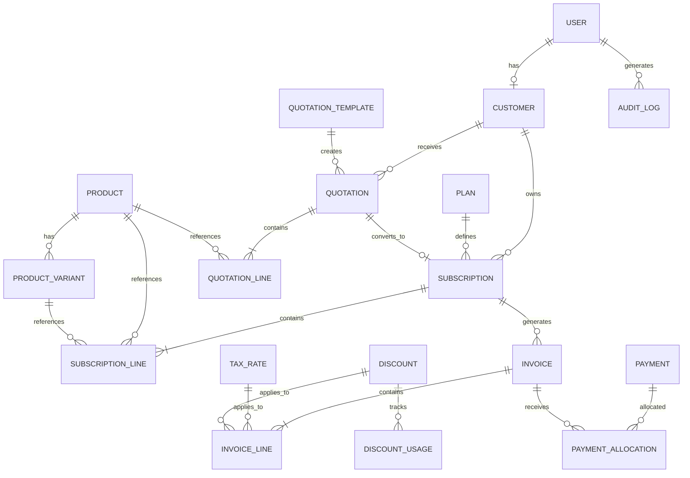

# Database Schema — Subscription Management System

**Database:** PostgreSQL  
**ORM:** Django ORM  
**Architecture:** Relational Database  
**Schema Version:** Initial Design — v1  
**Status:** Sprint 0 — Proposed

---

# 1. Introduction

This document defines the database structure of the Subscription Management System.

The database is designed to support the complete subscription lifecycle, including:

- User authentication and authorization.
- Customer management.
- Product and variant management.
- Subscription plan configuration.
- Quotations and quotation templates.
- Subscription lifecycle management.
- Automated recurring invoicing.
- Tax and discount calculations.
- Payment recording and reconciliation.
- Revenue analytics and reporting.

PostgreSQL is the primary persistent storage system.

The database will be managed using Django ORM and database migrations.

## 1.1 Design Principles

1. Maintain relational integrity through foreign keys.
2. Use normalized structures for core business entities.
3. Preserve historical financial information.
4. Use database transactions for financial operations.
5. Prevent duplicate billing operations.
6. Use decimal arithmetic for monetary values.
7. Apply appropriate indexes to frequently queried fields.
8. Avoid deleting historical financial records.
9. Maintain auditability of financial transactions.
10. Store timestamps consistently in UTC.

---

# 2. Database Overview

## 2.1 Core Entities

| Module | Entity | Description |
|---|---|---|
| Accounts | User | System users and authentication |
| Customers | Customer | Customer profiles |
| Products | Product | Product catalogue |
| Products | ProductVariant | Product variants |
| Plans | Plan | Subscription plans |
| Quotations | Quotation | Customer quotations |
| Quotations | QuotationLine | Quotation items |
| Quotations | QuotationTemplate | Reusable templates |
| Subscriptions | Subscription | Subscription records |
| Subscriptions | SubscriptionLine | Subscription items |
| Invoicing | Invoice | Billing records |
| Invoicing | InvoiceLine | Invoice items |
| Invoicing | TaxRate | Tax configuration |
| Discounts | Discount | Discount rules |
| Discounts | DiscountUsage | Discount application history |
| Payments | Payment | Payment records |
| Payments | PaymentAllocation | Payment-to-invoice allocation |
| System | AuditLog | Important activity records |

---

# 3. Entity Relationship Diagram

The following diagram describes the proposed relational structure.



---

# 4. Accounts Module

## 4.1 User

Represents every person who can access the system.

**Table:** `accounts_user`

| Field | Type | Constraints |
|---|---|---|
| id | BigAutoField | Primary Key |
| email | EmailField | Unique, Not Null |
| password | PasswordField | Not Null |
| first_name | CharField(100) | Not Null |
| last_name | CharField(100) | Blank Allowed |
| role | CharField(20) | admin, staff, customer |
| is_active | BooleanField | Default True |
| is_staff | BooleanField | Default False |
| date_joined | DateTimeField | Auto Created |
| updated_at | DateTimeField | Auto Updated |

### Relationships

- One user may have one customer profile.
- Admins can create staff accounts.
- Customers can own subscriptions and quotations.
- Users can generate audit records.

### Constraints

- Email addresses must be unique.
- Public registration can only create customer accounts.
- Staff creation must be restricted to administrators.

Use a custom Django user model from the beginning. Do not start with Django's default User and switch later.

---

# 5. Customers Module

## 5.1 Customer

Stores customer-specific business information.

**Table:** `customers_customer`

| Field | Type | Constraints |
|---|---|---|
| id | BigAutoField | Primary Key |
| user_id | ForeignKey(User) | Nullable, Unique |
| customer_code | CharField(30) | Unique |
| company_name | CharField(255) | Blank Allowed |
| phone | CharField(20) | Blank Allowed |
| billing_address | TextField | Blank Allowed |
| tax_identifier | CharField(100) | Blank Allowed |
| created_at | DateTimeField | Auto Created |
| updated_at | DateTimeField | Auto Updated |

### Relationships

- One customer can own multiple subscriptions.
- One customer can receive multiple quotations.
- One customer can receive multiple invoices.
- One customer can have multiple payment records.

A customer may represent an individual or a business.

---

# 6. Products Module

## 6.1 Product

Stores the products or services offered by the business.

**Table:** `products_product`

| Field | Type | Constraints |
|---|---|---|
| id | BigAutoField | Primary Key |
| name | CharField(255) | Not Null |
| product_type | CharField(30) | Not Null |
| sales_price | DecimalField(12,2) | Not Null |
| cost_price | DecimalField(12,2) | Not Null |
| description | TextField | Blank Allowed |
| notes | TextField | Blank Allowed |
| is_active | BooleanField | Default True |
| created_at | DateTimeField | Auto Created |
| updated_at | DateTimeField | Auto Updated |

Suggested product types:

- `service`
- `physical`
- `digital`

## 6.2 ProductVariant

Represents variations of a product.

**Table:** `products_productvariant`

| Field | Type | Constraints |
|---|---|---|
| id | BigAutoField | Primary Key |
| product_id | ForeignKey(Product) | Not Null |
| name | CharField(100) | Not Null |
| additional_price | DecimalField(12,2) | Default 0 |
| is_active | BooleanField | Default True |
| created_at | DateTimeField | Auto Created |

### Example

Product: Software Subscription

| Variant | Additional Price |
|---|---:|
| Standard | ₹0 |
| Odoo | ₹560 |
| Enterprise | ₹1,200 |

The effective unit price is calculated from the base price and selected variant pricing.

### Constraints

- Variant names should be unique within a product.
- Additional price cannot be negative unless explicitly supported by a business rule.
- Referenced variants must belong to the selected product.

---

# 7. Plans Module

## 7.1 Plan

Defines subscription pricing and billing configuration.

**Table:** `plans_plan`

| Field | Type | Constraints |
|---|---|---|
| id | BigAutoField | Primary Key |
| name | CharField(255) | Not Null |
| description | TextField | Blank Allowed |
| billing_interval | CharField(20) | daily, weekly, monthly, yearly |
| billing_interval_count | PositiveIntegerField | Default 1 |
| minimum_quantity | PositiveIntegerField | Default 1 |
| available_from | DateField | Not Null |
| available_until | DateField | Nullable |
| auto_close | BooleanField | Default False |
| allow_early_close | BooleanField | Default True |
| allow_pause | BooleanField | Default True |
| allow_renewal | BooleanField | Default True |
| is_active | BooleanField | Default True |
| created_at | DateTimeField | Auto Created |
| updated_at | DateTimeField | Auto Updated |

### Notes

The plan defines billing frequency and subscription lifecycle permissions.

The product and variant prices are stored separately and referenced by subscription line items.

This keeps plan configuration independent from product catalogue pricing.

---

# 8. Quotations Module

## 8.1 QuotationTemplate

Stores reusable quotation configurations.

**Table:** `quotations_quotationtemplate`

| Field | Type | Constraints |
|---|---|---|
| id | BigAutoField | Primary Key |
| name | CharField(255) | Not Null |
| description | TextField | Blank Allowed |
| validity_days | PositiveIntegerField | Not Null |
| is_active | BooleanField | Default True |
| created_at | DateTimeField | Auto Created |

## 8.2 Quotation

Represents an offer prepared for a customer.

**Table:** `quotations_quotation`

| Field | Type | Constraints |
|---|---|---|
| id | BigAutoField | Primary Key |
| quotation_number | CharField(50) | Unique |
| customer_id | ForeignKey(Customer) | Not Null |
| template_id | ForeignKey(QuotationTemplate) | Nullable |
| status | CharField(20) | Not Null |
| valid_until | DateField | Not Null |
| payment_terms | CharField(255) | Blank Allowed |
| subtotal | DecimalField(12,2) | Not Null |
| discount_total | DecimalField(12,2) | Default 0 |
| tax_total | DecimalField(12,2) | Default 0 |
| grand_total | DecimalField(12,2) | Not Null |
| created_by | ForeignKey(User) | Not Null |
| created_at | DateTimeField | Auto Created |
| updated_at | DateTimeField | Auto Updated |

Suggested statuses:

- `draft`
- `sent`
- `accepted`
- `rejected`
- `expired`
- `converted`

## 8.3 QuotationLine

Represents products and plans included in a quotation.

**Table:** `quotations_quotationline`

| Field | Type | Constraints |
|---|---|---|
| id | BigAutoField | Primary Key |
| quotation_id | ForeignKey(Quotation) | Not Null |
| product_id | ForeignKey(Product) | Not Null |
| variant_id | ForeignKey(ProductVariant) | Nullable |
| plan_id | ForeignKey(Plan) | Not Null |
| quantity | PositiveIntegerField | Greater than 0 |
| unit_price | DecimalField(12,2) | Not Null |
| line_total | DecimalField(12,2) | Not Null |

### Important

Quotation lines should preserve the quoted unit price even if the product price changes later.

---

# 9. Subscriptions Module

## 9.1 Subscription

Represents an active or prospective customer subscription.

**Table:** `subscriptions_subscription`

| Field | Type | Constraints |
|---|---|---|
| id | BigAutoField | Primary Key |
| subscription_number | CharField(50) | Unique |
| customer_id | ForeignKey(Customer) | Not Null |
| plan_id | ForeignKey(Plan) | Not Null |
| quotation_id | OneToOneField(Quotation) | Nullable |
| status | CharField(20) | Not Null |
| start_date | DateField | Not Null |
| expiry_date | DateField | Nullable |
| next_billing_date | DateField | Nullable |
| payment_terms | CharField(255) | Blank Allowed |
| created_by | ForeignKey(User) | Not Null |
| created_at | DateTimeField | Auto Created |
| updated_at | DateTimeField | Auto Updated |
| closed_at | DateTimeField | Nullable |

Suggested statuses:

- `draft`
- `quotation`
- `confirmed`
- `active`
- `paused`
- `closed`

### Relationships

- One customer can own multiple subscriptions.
- One plan can be associated with multiple subscriptions.
- One subscription can contain multiple line items.
- One subscription can generate multiple invoices.
- One accepted quotation can be converted into one subscription.

## 9.2 SubscriptionLine

Represents individual products within a subscription.

**Table:** `subscriptions_subscriptionline`

| Field | Type | Constraints |
|---|---|---|
| id | BigAutoField | Primary Key |
| subscription_id | ForeignKey(Subscription) | Not Null |
| product_id | ForeignKey(Product) | Not Null |
| variant_id | ForeignKey(ProductVariant) | Nullable |
| quantity | PositiveIntegerField | Greater than 0 |
| unit_price | DecimalField(12,2) | Not Null |
| created_at | DateTimeField | Auto Created |

### Important

The unit price is a historical snapshot.

Changes to the product catalogue must not silently modify existing subscription prices.

---

# 10. Invoicing Module

## 10.1 TaxRate

Stores administrator-configured tax rules.

**Table:** `invoicing_taxrate`

| Field | Type | Constraints |
|---|---|---|
| id | BigAutoField | Primary Key |
| name | CharField(100) | Not Null |
| rate | DecimalField(7,4) | Not Null |
| is_active | BooleanField | Default True |
| created_at | DateTimeField | Auto Created |

Tax calculation policies, applicability and jurisdiction-specific rules must be defined separately before production use.

## 10.2 Invoice

Represents a billing document generated from a subscription.

**Table:** `invoicing_invoice`

| Field | Type | Constraints |
|---|---|---|
| id | BigAutoField | Primary Key |
| invoice_number | CharField(50) | Unique |
| customer_id | ForeignKey(Customer) | Not Null |
| subscription_id | ForeignKey(Subscription) | Nullable |
| status | CharField(20) | Not Null |
| billing_period_start | DateField | Nullable |
| billing_period_end | DateField | Nullable |
| issue_date | DateField | Not Null |
| due_date | DateField | Not Null |
| subtotal | DecimalField(12,2) | Not Null |
| discount_total | DecimalField(12,2) | Default 0 |
| tax_total | DecimalField(12,2) | Default 0 |
| grand_total | DecimalField(12,2) | Not Null |
| amount_paid | DecimalField(12,2) | Default 0 |
| notes | TextField | Blank Allowed |
| created_at | DateTimeField | Auto Created |
| updated_at | DateTimeField | Auto Updated |

Suggested statuses:

- `draft`
- `confirmed`
- `paid`
- `cancelled`

Overdue and partially paid are derived conditions based on outstanding balance and due date, not additional invoice states.

## 10.3 InvoiceLine

Represents individual billed items.

**Table:** `invoicing_invoiceline`

| Field | Type | Constraints |
|---|---|---|
| id | BigAutoField | Primary Key |
| invoice_id | ForeignKey(Invoice) | Not Null |
| product_id | ForeignKey(Product) | Nullable |
| description | CharField(255) | Not Null |
| quantity | PositiveIntegerField | Greater than 0 |
| unit_price | DecimalField(12,2) | Not Null |
| discount_amount | DecimalField(12,2) | Default 0 |
| tax_rate | DecimalField(7,4) | Default 0 |
| tax_amount | DecimalField(12,2) | Default 0 |
| line_total | DecimalField(12,2) | Not Null |

### Important

Invoice lines must preserve historical descriptions, prices, discounts and tax values.

They must remain accurate even if the corresponding product or tax configuration changes later.

## 10.4 Recurring Billing Uniqueness

For subscription-generated invoices, the combination of:

- `subscription_id`
- `billing_period_start`
- `billing_period_end`

must be unique for each billable period.

Implement an appropriate conditional database constraint for subscription-generated invoices.

This is one of the most important protections against duplicate billing.

---

# 11. Discounts Module

## 11.1 Discount

Stores discount configuration.

**Table:** `discounts_discount`

| Field | Type | Constraints |
|---|---|---|
| id | BigAutoField | Primary Key |
| name | CharField(255) | Not Null |
| discount_type | CharField(20) | fixed, percentage |
| value | DecimalField(12,2) | Not Null |
| minimum_purchase | DecimalField(12,2) | Default 0 |
| minimum_quantity | PositiveIntegerField | Default 1 |
| scope | CharField(20) | product, subscription |
| starts_at | DateTimeField | Not Null |
| ends_at | DateTimeField | Nullable |
| usage_limit | PositiveIntegerField | Nullable |
| usage_count | PositiveIntegerField | Default 0 |
| is_active | BooleanField | Default True |
| created_at | DateTimeField | Auto Created |

## 11.2 DiscountProduct

Many-to-many relationship between discounts and eligible products.

**Table:** `discounts_discountproduct`

| Field | Type | Constraints |
|---|---|---|
| id | BigAutoField | Primary Key |
| discount_id | ForeignKey(Discount) | Not Null |
| product_id | ForeignKey(Product) | Not Null |

Unique constraint:

`(discount_id, product_id)`

## 11.3 DiscountUsage

Tracks every discount application.

**Table:** `discounts_discountusage`

| Field | Type | Constraints |
|---|---|---|
| id | BigAutoField | Primary Key |
| discount_id | ForeignKey(Discount) | Not Null |
| invoice_id | ForeignKey(Invoice) | Not Null |
| customer_id | ForeignKey(Customer) | Not Null |
| discount_amount | DecimalField(12,2) | Not Null |
| applied_at | DateTimeField | Auto Created |

Discount usage records provide a historical record of applied discounts.

Usage limits must be updated atomically to prevent concurrent applications from exceeding the configured limit.

---

# 12. Payments Module

## 12.1 Payment

Represents a recorded payment received by the business.

**Table:** `payments_payment`

| Field | Type | Constraints |
|---|---|---|
| id | BigAutoField | Primary Key |
| payment_reference | CharField(100) | Unique |
| customer_id | ForeignKey(Customer) | Not Null |
| amount | DecimalField(12,2) | Not Null |
| payment_method | CharField(30) | Not Null |
| payment_date | DateTimeField | Not Null |
| status | CharField(20) | Not Null |
| notes | TextField | Blank Allowed |
| recorded_by | ForeignKey(User) | Nullable |
| created_at | DateTimeField | Auto Created |

Suggested payment methods:

- `cash`
- `bank_transfer`
- `upi`
- `card`
- `online`
- `other`

Suggested statuses:

- `recorded`
- `pending`
- `failed`
- `reversed`

A recorded payment should not be silently deleted.

## 12.2 PaymentAllocation

Associates payments with invoices.

**Table:** `payments_paymentallocation`

| Field | Type | Constraints |
|---|---|---|
| id | BigAutoField | Primary Key |
| payment_id | ForeignKey(Payment) | Not Null |
| invoice_id | ForeignKey(Invoice) | Not Null |
| allocated_amount | DecimalField(12,2) | Not Null |
| created_at | DateTimeField | Auto Created |

### Why PaymentAllocation?

A payment can be allocated across multiple invoices, and an invoice can receive multiple payments.

This supports:

- Partial payments.
- Multiple payments against one invoice.
- One payment covering multiple invoices.
- Accurate outstanding balance calculation.

Database and application rules must ensure:

- Total allocations never exceed the payment amount.
- Total allocations never exceed an invoice's outstanding balance.
- Failed or reversed payments are not counted as collected revenue.

---

# 13. Audit Logging

## 13.1 AuditLog

Stores important system activities.

**Table:** `system_auditlog`

| Field | Type | Constraints |
|---|---|---|
| id | BigAutoField | Primary Key |
| user_id | ForeignKey(User) | Nullable |
| action | CharField(100) | Not Null |
| entity_type | CharField(100) | Not Null |
| entity_id | CharField(100) | Not Null |
| description | TextField | Blank Allowed |
| metadata | JSONField | Default Empty Dictionary |
| created_at | DateTimeField | Auto Created |

Audit events may include:

- User creation.
- Subscription activation.
- Subscription closure.
- Invoice generation.
- Invoice cancellation.
- Payment recording.
- Discount application.
- Plan modification.

Audit records should be append-only through the application workflow.

---

# 14. Database Constraints & Integrity

The following rules must be enforced wherever possible at the database level, with additional business validation in Django services.

## 14.1 Uniqueness

- User email.
- Customer code.
- Product variant name within a product.
- Quotation number.
- Subscription number.
- Invoice number.
- Payment reference.
- Discount-product combination.
- Subscription billing period.

## 14.2 Positive Values

- Product sales price.
- Product cost price.
- Variant additional price.
- Plan billing interval count.
- Subscription quantity.
- Invoice quantity.
- Payment amount.
- Discount usage count.

Discounts and financial amounts must also have appropriate upper and lower bounds.

## 14.3 Foreign Key Protection

Recommended deletion behavior:

| Relationship | Recommended Behavior |
|---|---|
| User → Customer | SET_NULL or PROTECT, depending on account policy |
| Product → Variant | PROTECT when referenced |
| Product → InvoiceLine | PROTECT |
| Customer → Subscription | PROTECT |
| Subscription → Invoice | PROTECT |
| Invoice → PaymentAllocation | PROTECT |
| Discount → DiscountUsage | PROTECT |

Historical financial records should never be removed merely because an associated product, customer or plan is archived.

Use `is_active` or archival fields where appropriate.

---

# 15. Indexing Strategy

Indexes should be added to frequently filtered and joined fields.

Recommended indexes:

| Table | Field(s) |
|---|---|
| User | email |
| Customer | customer_code |
| Product | is_active |
| Product | name |
| Plan | billing_interval |
| Quotation | quotation_number |
| Quotation | customer_id, status |
| Subscription | subscription_number |
| Subscription | customer_id, status |
| Subscription | next_billing_date, status |
| Invoice | invoice_number |
| Invoice | customer_id, status |
| Invoice | due_date |
| Invoice | subscription_id, billing_period_start, billing_period_end |
| Payment | payment_reference |
| Payment | customer_id, payment_date |

Use `select_related()` and `prefetch_related()` to avoid unnecessary database queries.

Index choices should be validated using actual query plans and representative data.

---

# 16. Financial Data Integrity

Financial correctness is a major architectural requirement.

### Monetary Fields

Use Django `DecimalField`, backed by PostgreSQL `NUMERIC`.

Recommended initial precision:

- Standard monetary amounts: `max_digits=12, decimal_places=2`.
- Percentage and tax rates: `max_digits=7, decimal_places=4`.

### Calculation Rules

All financial calculations must occur on the backend.

Example:

```text
Base Amount = Unit Price × Quantity

Discounted Amount = Base Amount - Discount

Tax Amount = Taxable Amount × Tax Rate

Invoice Total = Taxable Amount + Tax Amount
```

The exact tax base and discount ordering must follow the configured business rules.

### Important Rules

- Never use floating-point values for money.
- Never trust frontend-submitted invoice totals.
- Use transactions when creating invoices.
- Use transactions when recording payments.
- Preserve invoice snapshots.
- Maintain payment allocation history.
- Reconcile invoice balances against successful payment allocations.

---

# 17. Database Transaction Strategy

Transactions are mandatory for critical financial operations.

### Invoice Generation

A billing transaction should:

1. Lock or safely claim the eligible billing period.
2. Verify that an invoice does not already exist.
3. Calculate invoice line items.
4. Apply eligible discounts.
5. Calculate applicable taxes.
6. Create invoice and line records.
7. Record discount usage.
8. Commit the transaction.

### Payment Recording

A payment transaction should:

1. Validate the payment reference.
2. Lock relevant invoice balances.
3. Create the payment record.
4. Create payment allocations.
5. Recalculate outstanding balances.
6. Update invoice payment status where appropriate.
7. Commit the transaction.

Use `transaction.atomic()` and appropriate row-level locking where necessary.

---

# 18. Database Migration Strategy

Django migrations manage schema changes.

### Create Migrations

```bash
docker compose exec backend python manage.py makemigrations
```

### Apply Migrations

```bash
docker compose exec backend python manage.py migrate
```

### Inspect Migration Plan

```bash
docker compose exec backend python manage.py migrate --plan
```

### Show Migration Status

```bash
docker compose exec backend python manage.py showmigrations
```

### Rules

- Commit migration files.
- Never edit an already-applied migration casually.
- Coordinate changes to shared models.
- Test migrations before merging.
- Never delete production data through schema migrations without an approved data migration and backup strategy.

---

# 19. Sprint-wise Database Implementation

| Sprint | Database Scope |
|---|---|
| Sprint 1 | Database configuration and initial project setup |
| Sprint 2 | User and customer models |
| Sprint 3 | Product, ProductVariant and Plan |
| Sprint 4 | Quotation, QuotationLine, QuotationTemplate, Subscription and SubscriptionLine |
| Sprint 5 | Invoice, InvoiceLine and TaxRate |
| Sprint 6 | Discount, DiscountProduct, DiscountUsage, Payment and PaymentAllocation |
| Sprint 7 | Analytics query optimization and AuditLog |
| Sprint 8 | Constraints, indexes, integrity checks and migration validation |

---

# 20. Future Considerations

The following are potential extensions, not mandatory initial entities:

- Subscription change history.
- Credit notes and refunds.
- Payment gateway transaction records.
- Multiple currencies.
- Multi-tenant organization management.
- Notification preferences.
- Automated dunning and retry policies.
- Subscription add-on management.
- Revenue recognition records.

These should be introduced only when the business requirements justify them.

---

# 21. Final Design Summary

The proposed database provides a relational foundation for the entire subscription management workflow.

Its core design priorities are:

1. Reliable customer and subscription relationships.
2. Historical pricing and invoice accuracy.
3. Duplicate-proof recurring billing.
4. Flexible payment-to-invoice allocation.
5. Auditable financial records.
6. Database-level integrity.
7. Efficient reporting and querying.

**Database Owner:** Jeevandas  
**Backend:** Django ORM  
**Database:** PostgreSQL  
**Schema Status:** Initial Design — Sprint 0

**Design Principle:** Financial history must remain accurate, even when the business configuration changes.
